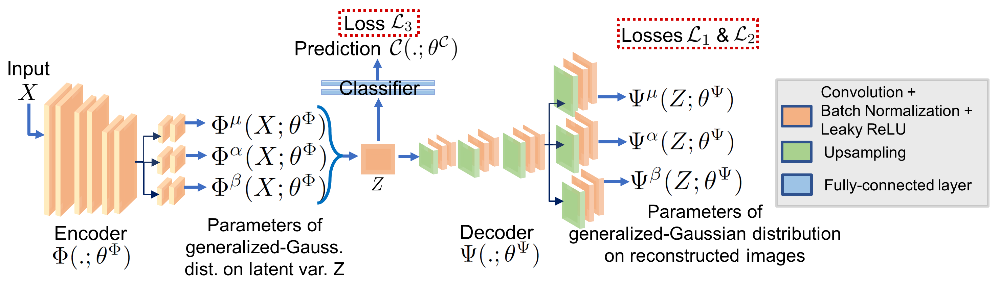
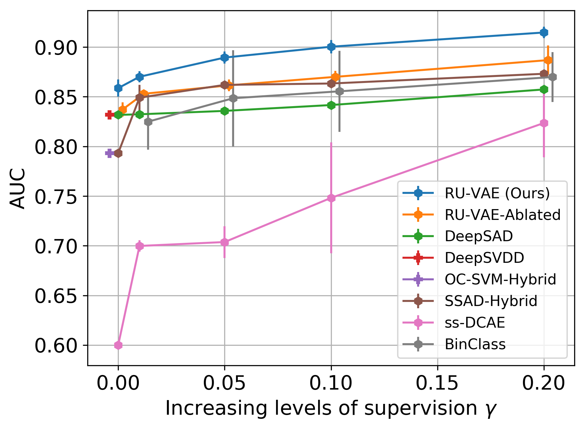
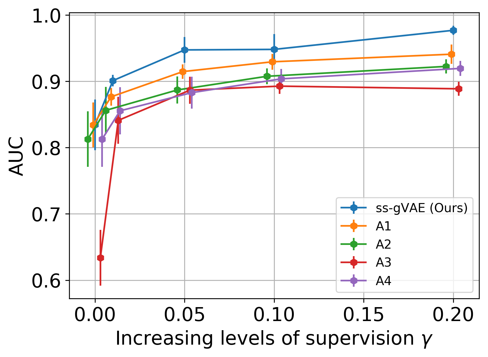
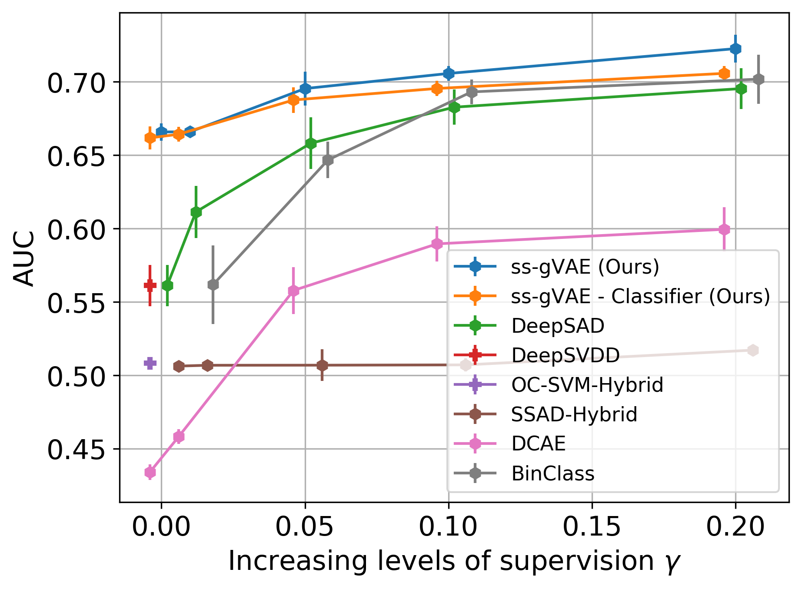
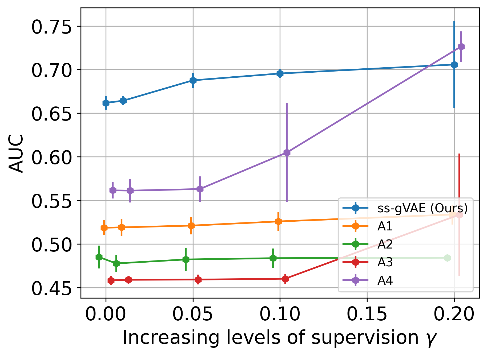

# RU-VAE (ISBI 2022) — thesis Chapter 4

Code for **robust semi-supervised VAE** experiments on **malaria blood-smear patches** and **nanofibre** imagery, as in the ISBI 2022 paper and PhD thesis Chapter 4.

> This repository is **not** the ss-gVAE (WACV 2022) codebase. For ss-gVAE, see [`RenukaSharma/ss-gVAE`](https://github.com/RenukaSharma/ss-gVAE). A compact map of thesis chapters to repositories is maintained in the ss-gVAE README.

## Paper and conference materials

This is the **only** public repository for RU-VAE / c-ss-gVAE (code, figures, and paper files). The older [`RenukaSharma/RUVAE`](https://github.com/RenukaSharma/RUVAE) listing is a redirect here.

- **IEEE Xplore (ISBI 2022):** [document 9761472](https://ieeexplore.ieee.org/document/9761472)
- **Camera-ready PDF:** [`docs/paper/mainCameraReady_curr.pdf`](docs/paper/mainCameraReady_curr.pdf)
- **Poster:** [`docs/paper/144_ISBI_poster.pdf`](docs/paper/144_ISBI_poster.pdf)
- **Oral slides:** [`docs/paper/144_ISBI_presentation.pdf`](docs/paper/144_ISBI_presentation.pdf)
- Extra Drive copy of the camera-ready: [Google Drive](https://drive.google.com/file/d/1fapKVmd193qVkeJokayVqOOKCsm52Kqg/view)

## Scope of this release

The tree is reduced to **two datasets** and the networks used with them:

| Dataset (CLI name) | Typical `net_name` |
|--------------------|--------------------|
| `malaria_dataset`  | `cifar10_LeNet` (32×32 RGB patches) or `malaria_net` |
| `nanofibre`        | `nanofibre_vae` |

Supporting code lives under `src/` (DeepSAD-style training, SSAD hybrid baseline) and `binary_classifier/` (binary-classifier baseline).

## Results (your figures)

Figures below are the ISBI 2022 / thesis Chapter 4 plots, stored in [`docs/figures/`](docs/figures/). They are **not** copied from the ss-gVAE repository.

### Method overview

  

> **Figure 1.** Robust and Uncertainty-Aware VAE (RU-VAE / c-ss-gVAE) for one-class classification. From the ISBI 2022 camera-ready.

### Malaria (patch dataset)

  
  &nbsp;
  

### Nanofibre

  
  &nbsp;
  

Malaria t-SNE from the ISBI camera-ready is in [`docs/figures/tsne/malaria_ruvae.png`](docs/figures/tsne/malaria_ruvae.png).

## Quick start

See [`docs/reproducing_paper.md`](docs/reproducing_paper.md) for environment setup, data layout, and example commands.

## Place in the PhD thesis

This work is **Chapter 4** of the PhD thesis *"Anomaly Detection in Images Using One-class and Multi-class Learning Approaches"* (Renuka Sharma, IITB-Monash Research Academy, 2022).

- Monash Bridges: <https://bridges.monash.edu/articles/thesis/Anomaly_Detection_in_Images_Using_One-class_and_Multi-class_Learning_Approaches/23584503>
- DOI: [`10.26180/23584503`](https://doi.org/10.26180/23584503)

Companion repositories from the same thesis:

| Chapter | Topic | Repository |
| ------- | ----- | ---------- |
| Ch. 3 | ss-gVAE (WACV 2022) | [`ss-gVAE`](https://github.com/RenukaSharma/ss-gVAE) |
| Ch. 4 | RU-VAE (ISBI 2022) — **this repository** | [`c-ss-gVAE`](https://github.com/RenukaSharma/c-ss-gVAE) (here) |
| Ch. 5 | c-ss-ms-gVAE (Neurocomputing) | [`c-ss-ms-gVAE`](https://github.com/RenukaSharma/c-ss-ms-gVAE) |
| Ch. 6 | Anomaly localization (ss-vq-vae) | [`ss-vq-vae`](https://github.com/RenukaSharma/ss-vq-vae) (in preparation) |

## Citation

See [`CITATION.cff`](CITATION.cff) for software metadata and the **preferred citation** to the ISBI paper. If you cite the repository software separately, credit the maintainer listed there.

## License

[MIT](LICENSE). Copyright line may be adjusted if your institution requires a different attribution; open an issue or PR text if needed.
